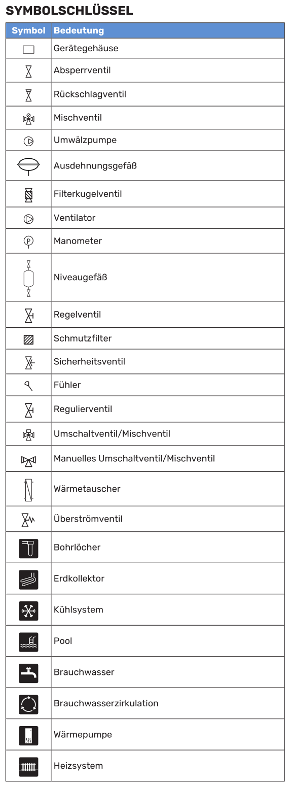
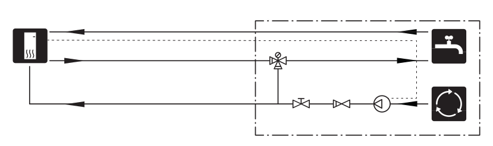

##################
Aufbau der Heizung
##################

NIBE Wärmepumpe
===============

Mit dem Zubehör AXC können zusätzliche Funktionen umgesetzt werden.

.. figure:: ./images/NIBE_AA25.*

NIBE bietet dazu 3 Varianten von AXC an, laut dem technischen Berater der Firma NIBE sind diese jedoch alle baugleich und können per DIP-Schalter auf die benötigte Funktion eingestellt werden.

.. note::

	Die Funktionsbeschreibungen in diesem Abschnitt sind den NIBE-Zubehörhandbüchern entnommen. Dort beziehen sich einzelne Sätze auf andere Baureihen, etwa F1345 oder F1355, weil dasselbe Zubehör für mehrere Wärmepumpen gilt. Für Programmversionen und Klemmenbezeichnungen ist deshalb immer das Handbuch der **S1256** maßgeblich, nicht der zitierte Text.

	Was in dieser Anlage tatsächlich verbaut und eingestellt ist, steht unter :ref:`ref_ist_konfiguration`.

In den Handbüchern sind diese Funktionen den einzelnen Varianten zugeordnet:

AXC 30:

* Mischventilgesteuerte Zusatzheizung
* **Stufengeregelte Zusatzheizung**
* **Zusätzlicher Heiz- und Kühlkreis**
* Brauchwasserkomfort
* Aktive Kühlung (Vierrohr)
* Anschluss mehrerer Wärmepumpen

AXC 40

* Mischventilgesteuerte Zusatzheizung
* Stufengeregelte Zusatzheizung
* Pumpe für Brauchwasserzirkulation
* Grundwasserpumpe

AXC 50

* **mischventilgesteuerte Zusatzheizung**
* stufengeregelte Zusatzheizung
* Grundwasserpumpe
* zusätzliches Klimatisierungssystem
* Brauchwasserkomfort
* passive Kühlung (Vierrohrsystem)
* **passive Kühlung (Zweirohrsystem)AA5-S2**
* passive/aktive Kühlung (Zweirohrsystem)
* mischventilgesteuertes Wärmequellenmedium
* Poolerwärmung.

.. _ref_00000101:

mischventilgesteuerte Zusatzheizung
------------------------------------

DIP ``0000 0101``

Mit dieser Funktion kann eine externe Zusatzheizung, z.B. ein Öl- oder Gasheizkessel bzw. ein Fernwärmeübertrager, den Heizbetrieb unterstützen.

Das Innenmodul steuert ein Mischventil (QN11) und eine Umwälzpumpe (GP10) über die Zubehörplatine in AXC 30/40/50. Kann die Wärmepumpe die korrekte Vorlauftemperatur (BT25) nicht aufrechterhalten, startet die Zusatzheizung. Nach einem Anstieg der Kesseltemperatur (BT52) auf ca. 55 °C sendet das Innenmodul ein Signal an das Mischventil (QN11), um den Zufluss von Heizungswasser freizugeben. Das Mischventil (QN11) wird so geregelt, dass die tatsächliche Vorlauftemperatur dem theoretisch errechneten Sollwert des Innenmoduls entspricht. Wenn der Heizbedarf so weit sinkt, dass keine Zusatzheizung mehr benötigt wird, schließt sich das Mischventil (QN11) vollständig. Die Werkseinstellung für die minimale Laufzeit, die den Heizkessel in Bereitschaft hält, beträgt 12 h (einstellbar in Menü 5.3.2).

Ab Softwareversion 8061R4 kann das Mischventil (QN11) mit einem analogen Steuersignal von 0-10 V gesteuert werden.

Die Funktion „smart energy source“ kann ausgewählt werden, wenn eine automatische Festlegung des Vorrangs zwischen Wärmepumpen- und Zusatzheizungsbetrieb je nach niedrigstem Preis oder geringster Umweltbelastung stattfinden soll.

.. _ref_00010111:

Stufengeregelte Zusatzheizung
-----------------------------

DIP ``0001 0111``

Mit dieser Funktion kann eine externe Zusatzheizung, z.B. ein Elektroheizkessel, den Heizbetrieb unterstützen.

Mit der Zubehörplatine in AXC 30/40/50 stehen drei weitere potenzialfreie Relais für die Steuerung der Zusatzheizung zur Verfügung. Dies ergibt zusätzlich 3 lineare oder 7 binäre Stufen.

Der Volumenstrom durch die Zusatzheizung wird entweder mit der Ladepumpe (GP12) oder der externen Umwälzpumpe (GP10) sichergestellt.

Eine externe stufengeregelte Zusatzheizung kann über bis zu drei potenzialfreie Relais (3 Stufen linear oder 7 Stufen binär) gesteuert werden. Mit dem Zubehör AXC 50 stehen drei weitere potenzialfreie Relais für eine Zusatzheizungssteuerung zur Verfügung.

Dies ergibt dann maximal 3 + 3 lineare oder 7 + 7 binäre Stufen.

Der Volumenstrom durch die Zusatzheizung wird entweder mit der Ladepumpe (GP12) oder der externen Umwälzpumpe (GP10) sichergestellt.

Ab Softwareversion 7952R2 kann die stufengeregelte Zusatzheizung auch mit einem analogen Steuersignal von 0-10 V gesteuert werden.

.. figure:: ./images/NIBE_AXC30_elektrische_zusatzheizung.*

.. _ref_00000010:

Zusätzlicher Heiz- und Kühlkreis
--------------------------------

DIP für Klimatisierungssystem 2: ``0000 0010``

Diese Zubehörfunktion wird eingesetzt, wenn ein Haus mehrere Klimatisierungssysteme hat, die mit unterschiedlichen Vorlauftemperaturen betrieben werden sollen, zum Beispiel Heizkörper und Fußbodenheizung.

.. important::

	Das Zusatzsystem muss eine **niedrigere** Betriebstemperatur haben als Klimatisierungssystem 1. Das ist keine Empfehlung, sondern eine Installationsvoraussetzung des Herstellers, und sie hat eine physikalische Ursache: das Mischventil kann nur beimischen, also absenken. Fordert das Zusatzsystem mehr, als im Vorlauf ansteht, bleibt ihm nur, vollständig zu öffnen, und seine eigene Heizkurve ist ohne Wirkung.

	Wie sich das in dieser Anlage auswirkt und wie man es erkennt, steht in :doc:`raumtemperatur`.

.. _ref_00101001:

Brauchwasserkomfort
-------------------

DIP ``0010 1001``

Diese Funktion ermöglicht vorübergehenden Luxus, Mischventil und Brauchwasserzirkulation.

Vorübergehender Luxus (Extra-Brauchwasser)
	Wenn eine Elektroheizpatrone im Speicher installiert ist, kann zeitgleich Brauchwasserwärme erzeugt werden, während die Wärmepumpe gleichzeitig dem Heizbetrieb Vorrang einräumt.

Mischventil
	Ein Fühler ermittelt die Brauchwasser-Austrittstemperatur zum Brauchwassernetz und stellt das Mischventil am letzten Brauchwasserspeicher entsprechend ein, bis die Solltemperatur erreicht wurde.

Brauchwasserzirkulation (BWZ)
	Eine Pumpe kann zeitgesteuert die Brauchwasserzirkulation vornehmen

.. _ref_00001001:

Brauchwasserzirkulation
-----------------------

DIP ``0000 1001``

Eine Pumpe kann zeitgesteuert die Brauchwasserzirkulation vornehmen.

.. _ref_00010011:

Passive Kühlung im Vierrohrsystem
---------------------------------

DIP ``0001 0011``

Das Kühlsystem ist mit dem Wärmequellenkreis der Wärmepumpe verbunden, wobei die Kältezufuhr vom Kollektor über die Umwälzpumpe und das Mischventil
erfolgt.

Bei einem Kühlbedarf (eine Auslösung erfolgt per Außenfühler und evtl. vorhandenem Raumfühler) wird die Umwälzpumpe aktiviert. Das Mischventil führt die Steuerung so aus, dass der Kältefühler den aktuellen Sollwert entsprechend der Außenlufttemperatur sowie den eingestellten Minimalwert für die Kühltemperatur erreicht (damit sich keine Kondensflüssigkeit bildet).

.. attention:: Dieses Zubehör kann eine Aktualisierung der Software in F1345/F1355 erforderlich machen. In der Wärmepumpe wird mindestens Programmversion 2755 benötigt.

.. _ref_00010010:

Passive Kühlung im Zweirohrsystem
---------------------------------

DIP ``0001 0010``

Der Wärmequellenkreis ist über ein Umschaltventil mit einem Wärmeübertrager verbunden. Die Sekundärseite des Wärmeübertragers ist mit dem Heizkreis über ein Mischventil und eine Umwälzpumpe verbunden.

Bei einem Kühlbedarf (eine Auslösung erfolgt per Außenfühler und evtl. vorhandenem Raumfühler oder per Fernbedienung) werden das Mischventil und die Umwälzpumpe aktiviert. Das Mischventil sorgt unter anderem dafür, dass der Kältefühler den aktuellen Sollwert entsprechend der Aussenlufttemperatur erreicht sowie den eingestellten Minimalwert für die Kühltemperatur nicht unterschreitet (damit sich keine Kondensflüssigkeit bildet).

.. attention:: Dieses Zubehör kann eine Aktualisierung der Software in F1345/F1355 erforderlich machen. In der Wärmepumpe wird mindestens Programmversion 2755 benötigt.

Zubehör
=======

.. note::

	Der folgende Abschnitt listet die Zubehörvarianten auf, die NIBE für diese Baureihe anbietet. Es sind **Alternativen aus dem Katalog**, nicht die Bestückung dieser Anlage. Was hier verbaut ist, steht unter :ref:`ref_ist_konfiguration`: drei Zubehörplatinen AXC, ein zusätzliches Klimatisierungssystem für die Fußbodenheizung, eines für die Heizkörper und die passive Kühlung im Zweirohrsystem. Weder ECS 40 oder ECS 41 noch PCS 44 sind hier im Einsatz.

Zusätzlicher Heiz- und Kühlkreis
	In Gebäuden mit mehreren Klimatisierungssystemen, die unterschiedliche Vorlauftemperaturen erfordern, kann das Zubehör ECS 40/ECS 41 angeschlossen werden. Ein Mischventil senkt hierbei die Temperatur z. B. für die Fußbodenheizung.

	.. figure:: ./images/NIBE_ecs40_ecs41.png

	.. figure:: ./images/NIBE_zusaetzlicher_heizkreis.png

	:download:`Zubehör ECS 40/ECS 41 </_static/datenblaetter/NIBE_ECS_41_231401-2.pdf>`

Kühlung
	Das Zubehör PCS 44 ermöglicht den Anschluss von passiver Kühlung, z.B. mit Gebläsekonvektoren. Das Kühlsystem wird mit dem Wärmequellenkreis der Wärmepumpe verbunden, wobei die Kältezufuhr vom Kollektor über eine Umwälzpumpe und das Mischventil erfolgt.

	Um eine Kondensatbildung zu vermeiden, müssen Rohrleitungen und andere kalte Oberflächen mit diffusionsdichtem Material isoliert werden.

	Liegt ein hoher Kühlbedarf vor, sind Kälteverbraucher mit Tropfschale und Kondensatanschluss erforderlich.

	Das Wärmequellensystem ist mit einem Druckausdehnungsgefäß auszustatten. Ein eventuell vorhandenes Niveaugefäß wird ersetzt.

	.. figure:: ./images/NIBE_passive_kuehlung.png

Außenfühler
	Der Außenluftfühler (BT1) ist an einem schattigen Platz an der Nord- oder Nordwestseite des Hauses zu befestigen, wo keine störende Einstrahlung z. B. durch die Morgensonne erfolgt.

	Der Außenluftfühler wird an Anschlussklemme AA2-X28:14 und AA2-X29:GND angeschlossen.

Zubehör mit Zubehörplatine (AA5)
	Zubehör mit Zubehörplatine (AA5) wird an Anschlussklemme AA2-X30:1, 3, 4 in S1256 angeschlossen.

Verfügbare Eingänge
	Verfügbare Eingänge an der Basisplatine (AA2) für diese Funktionen sind AA2-X28:3-11. Die jeweilige Funktion wird an den verfügbaren Eingang sowie an GND (AA2-X29) angeschlossen.

Verfügbare Ausgänge
	Verfügbarer Ausgang: AA2-X27. Der Ausgang ist ein potenzialfrei wechselndes Relais. Ist S1256 abgeschaltet oder im Reservebetrieb, befindet sich das Relais im Modus C-NC.

.. attention:: Der Relaisausgang darf mit maximal 2 A bei Wirklast (230 V~) belastet werden.

.. hint:: Das Zubehör AXC ist erforderlich, wenn mehr als eine Funktion mit dem AUX-Ausgang verbunden werden soll.

.. _ref_aux:

Die AUX-Eingänge sind frei belegbar
-----------------------------------

.. warning::

	Eine frühere Fassung dieser Dokumentation hat die Klemmen ``AA2-X28:3`` bis ``:11`` mit festen Funktionen aufgelistet, etwa ``X28:5`` als externen Rücklauffühler. **Das war falsch.** Die Klemmen sind nicht funktionsgebunden. Das Handbuch listet an dieser Stelle lediglich auf, welche Funktionen man einem AUX-Eingang *zuweisen kann*; welche Funktion auf welchem Eingang liegt, wird in Menü 7.4 „Verfügbare Ein-/Ausgänge“ festgelegt.

Die Klemmen auf der Basisplatine (AA2) sind den AUX-Eingängen fest zugeordnet, die Funktion dahinter ist frei wählbar:

.. list-table:: Klemmenzuordnung der AUX-Eingänge
	:header-rows: 1
	:stub-columns: 1

	*	-	Klemme
		-	Eingang

	*	-	AA2-X28:3
		-	AUX1

	*	-	AA2-X28:4
		-	AUX2

	*	-	AA2-X28:5
		-	AUX3

	*	-	AA2-X28:6
		-	AUX4

	*	-	AA2-X28:7
		-	AUX5

	*	-	AA2-X28:8
		-	AUX6

Die jeweilige Funktion wird an den Eingang und an GND (AA2-X29) angeschlossen. Der Außenluftfühler (BT1) liegt **nicht** auf einem AUX-Eingang, sondern auf AA2-X28:14, der externe Vorlauffühler (BT25) auf AA2-X28:12.

Als Fühler stehen laut Handbuch zur Auswahl:

* sechs frei platzierbare Fühler BT37.1 bis BT37.6
* Kühlung/Heizung (BT74), entscheidet über die Umschaltung zwischen Kühl- und Heizbetrieb
* externer Rücklauffühler (BT71)
* anzeigender Brauchwasserfühler für die Zirkulation (BT70), am Vorlauf
* anzeigender Brauchwasserfühler für die Zirkulation (BT82), am Rücklauf

Dazu kommen Wächterfunktionen, etwa ein Alarm von externen Einheiten, ein Druckwächter für das Klimatisierungssystem oder ein Niveau-, Druck- und Volumenstromwächter für das Wärmequellenmedium, sowie eine Reihe von Funktionsaktivierungen über potenzialfreie Kontakte.

Über Modbus wird die Zuordnung als Funktions-ID in das jeweilige Register geschrieben. Die vollständige Liste der IDs steht in der technischen Information „MODBUS S-SERIES“. Ein Auszug der hier relevanten Werte:

.. list-table:: Funktions-IDs für AUX-Eingänge, Auszug
	:header-rows: 1
	:stub-columns: 1

	*	-	ID
		-	Funktion
		-	Art

	*	-	2
		-	externe Verstellung aktivieren
		-	Kontakt

	*	-	6
		-	Heizung blockieren
		-	Kontakt

	*	-	13
		-	Niveauwächter Wärmequellenmedium
		-	Kontakt

	*	-	20
		-	SG Ready, Eingang A
		-	Kontakt

	*	-	21
		-	SG Ready, Eingang B
		-	Kontakt

	*	-	27
		-	Rücklauftemperatur (BT71)
		-	Fühler

	*	-	49, 50, 62, 63
		-	frei platzierbare Fühler BT37.1 bis BT37.4
		-	Fühler

.. list-table::
	:header-rows: 1
	:stub-columns: 1

	*	-	Ausgang
		-	Funktion

	*	-	AA2-X27
		-	potenzialfrei wechselndes Relais, frei belegbar

.. _ref_ist_konfiguration:

Konfiguration dieser Anlage
===========================

Verbaut sind **drei Zubehörplatinen**, die über DIP-Schalter auf unterschiedliche Funktionen eingestellt sind.

.. list-table:: Zubehörplatinen
	:header-rows: 1
	:stub-columns: 1

	*	-	Platine
		-	Funktion
		-	Kennung

	*	-	AXC 50 (AA25)
		-	passive Kühlung im Zweirohrsystem
		-	\-

	*	-	AXC 30
		-	zusätzliches Klimatisierungssystem, Fußbodenheizung
		-	EP21, CS2

	*	-	AXC 30
		-	zusätzliches Klimatisierungssystem, Heizkörper Obergeschoss
		-	EP22, CS3

.. note::

	In älteren Notizen zu dieser Anlage heißen die Platinen „AXS-Box 1/2/3“. Laut Rechnung sind es drei Stück **AXC 30**; die Kühlfunktion folgt der Beschreibung aus dem Handbuch des AXC 50, weil dort das Kapitel „Passive Kühlung im Zweirohrsystem“ steht. Die Zubehörteile ECS 40 und ECS 41, die das Handbuch für einen zusätzlichen Heizkreis nennt, sind hier **nicht** verbaut.

Belegung der AUX-Eingänge, aus den Registern gelesen:

.. list-table:: Tatsächliche AUX-Belegung
	:header-rows: 1
	:stub-columns: 1

	*	-	Eingang
		-	ID
		-	Funktion

	*	-	AUX1
		-	13
		-	Niveauwächter Wärmequellenmedium

	*	-	AUX2
		-	27
		-	externer Rücklauffühler BT71

	*	-	AUX3 bis AUX7
		-	0
		-	frei

	*	-	AUX8
		-	20
		-	SG Ready, Eingang A

	*	-	AUX9
		-	21
		-	SG Ready, Eingang B

.. hint::

	Der externe Rücklauffühler BT71 gehört zur Kühlfunktion. Das Handbuch des AXC 50 schreibt für die passive Kühlung im Zweirohrsystem vor, ihn am Rücklauf des Klimatisierungssystems anzubringen, als Anlegefühler mit Wärmeleitpaste und Aluminiumband. Weil in dieser Anlage zusätzlich der Pufferspeicher zwischen Hauskreis und Wärmepumpe sitzt, misst er dort faktisch die Temperatur am Pufferausgang und nicht das Gemisch der beiden Kreisrückläufe. Für die Regelung ist das ohne Folgen, der Messwert heißt aber irreführend.

Platine 1: passive Kühlung
--------------------------

DIP ``0001 0010``

Steuert die Kühlfunktion über den Plattenwärmeübertrager EP24. Das Umschaltventil QN12 im Solevorlauf leitet die Sole im Kühlbetrieb über den Übertrager statt über den Verdampfer, die Umwälzpumpe GP13 fördert den Hauskreis, und das Mischventil QN18 im Rücklauf hält die Vorlauftemperatur über dem eingestellten Minimum, damit sich kein Kondensat bildet. Der externe Vorlauffühler BT25 ist dabei die Regelgröße.

.. seealso:: :ref:`ref_00010010`

Platine 2: Fußbodenheizung, Klimatisierungssystem 2
---------------------------------------------------

DIP ``0000 0010``

Versorgt 16 Heizkreise, zehn im Erdgeschoss und sechs im Untergeschoss, über EP21. Diese Platine hat ein **Mischventil** und senkt damit die Puffertemperatur auf den Sollwert von CS2 ab. Vorlauf- und Rücklauffühler (EP21-BT2 und EP21-BT3) gehören zum Lieferumfang und werden für die Mischerregelung gebraucht.

Einstellbar sind Mischventilverstärkung und Mischventilwartezeit sowie die Pumpensteuerung. **Keine** dieser Einstellungen wirkt auf die Wärmeerzeugung; dazu :doc:`raumtemperatur`.

.. seealso:: :ref:`ref_00000010`

Platine 3: Heizkörper Obergeschoss, Klimatisierungssystem 3
-----------------------------------------------------------

DIP ``0000 0010``

Versorgt die Heizkörper im Obergeschoss über EP22. Die Platine ist wie Platine 2 als zusätzliches Klimatisierungssystem konfiguriert und meldet sich der Regelung auch als gemischtes System, **hydraulisch ist hier aber kein Mischventil verbaut**.

.. admonition:: Gemessen

	Der Unterschied zwischen den beiden Kreisen lässt sich an den Fühlern nachweisen. Über 209 Heizphasen betrug die Absenkung zwischen Puffervorlauf und Kreisvorlauf

	* am Heizkörperkreis EP22 im Median **2,51 K**, was dem Leitungsverlust entspricht,
	* am Fußbodenkreis EP21 im Median **4,14 K**, also eine echte Mischung.

	Der Vergleich der beiden Kreise ist der Beleg: der eine mischt, der andere nicht.

Praktische Folge: Der Sollwert von CS3 ist eine Anforderung an den Puffer, kein Stellsignal. Es gibt nichts, was den Vorlauf für das Obergeschoss herunterregeln könnte. Eine Mindestvorlauftemperatur auf CS3 wirkt deshalb nur nach oben, nie nach unten.

Die zweite Aufgabe dieser Platine ist die **Trennung der Heizkörper im Kühlbetrieb**. Ohne sie würde am Heizkörper Kondensat anfallen.

.. seealso:: :ref:`ref_00000010`

Installationsvariante Brauchwasserzirkulation
=============================================

Eine Umwälzpumpe zur Zirkulation des Brauchwassers kann von S1256 gesteuert werden. Das zirkulierende Wasser muss eine Temperatur haben, die sowohl eine Bakterienansiedlung als auch ein Verbrühen verhindert; nationale Normen sind zu beachten.

Der BWZ-Rücklauf kann mit Anschluss XL5 bzw. mit einem freistehenden Brauchwasserspeicher verbunden werden. Wenn nach der Wärmepumpe ein elektrischer Brauchwasserspeicher angeschlossen wird, muss der BWZ-Rücklauf mit dem Speicher verbunden werden.

Die Umwälzpumpe wird über den AUX-Ausgang in Menü 7.4 - „Verfügbare Ein-/Ausgänge“ aktiviert.

Die BWZ kann um Brauchwasserfühler für BWZ (BT70) und (BT82) ergänzt werden, die über den AUX-Eingang in Menü 7.4 - „Verfügbare Ein-/Ausgänge“ angeschlossen werden.

Optionen bei mangelhafter Heizleistung
======================================

Zusätzlicher Brauchwasserspeicher
---------------------------------

Wenn eine größere Badewanne oder ein anderer großer Brauchwasserverbraucher angeschlossen wird, sollte die Anlage um einen zusätzlichen Brauchwasserspeicher ergänzt werden.

Brauchwasserspeicher mit Elektroheizpatrone
	In einem Brauchwasserspeicher mit Elektroheizpatrone wird das Wasser primär von der Wärmepumpe erwärmt. Die Elektroheizpatrone des Brauchwasserspeichers wird zum Warmhalten verwendet sowie bei nicht ausreichender Leistung der Wärmepumpe.
